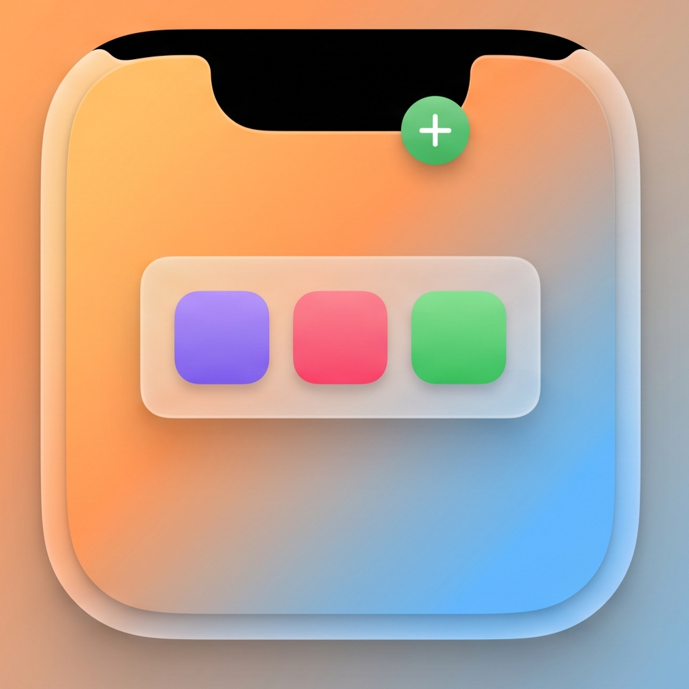

<div align="center">



# NotchCraft

**A sleek, native macOS notch utility and Dynamic Island control center built with SwiftUI & AppKit.**

[](https://www.apple.com/macos/)
[](https://github.com/RahulDhakad01/Notchcraft/releases/latest)
[](https://swift.org/)
[](https://apple.com)
[](LICENSE)

</div>

---

## 🌟 Overview

**NotchCraft** brings an interactive utility bar right to the camera notch of your Mac. Hover, tap, or drag a file to the top of your display—the compact pill expands into a versatile HUD packed with productivity tools:

- 📥 **File Shelf & Drag-and-Drop Tray**: Stage files, preview with QuickLook (`Space`), AirDrop, or drag them out anytime.
- 📸 **Automatic Screenshot Capture**: Newly taken macOS screenshots automatically slip into the tray for instant sharing.
- 🎵 **Apple Music Mini-Player**: Live playback scrubber, animated wave visualizer, and track controls via native Apple Events.
- ⏱️ **Focus Timer & Stopwatch**: Pomodoro-style countdown presets (25m, 15m, 5m), custom timer durations, lap recorder, chime alerts, and notifications.
- 📋 **Clipboard History & Snippets**: Seamless pasteboard capture, quick copy-back, and pinned snippet library.
- 📝 **Quick Notes & Apple Notes Sync**: Draft thoughts on the fly and sync or create real Apple Notes with one click.
- 🌤️ **Live Weather**: Current temperature, forecasts, and weather conditions powered by Open-Meteo (privacy-friendly, no API keys needed).
- 📅 **Calendar Snapshot**: Upcoming EventKit calendar events previewed right in the notch.
- 🚀 **App Launcher & Switcher**: Instant shortcuts to Safari, Finder, Notes, Calendar, Music, and your most recent apps.
- ⚙️ **Menu Bar Integration & Auto-Launch**: Quick toggle, UI reset, recenter, and native Ventura/Sonoma/Sequoia `SMAppService` startup on sign-in.

---

## 🛠️ Architecture & Tech Stack

- **Pure Native Swift & SwiftUI**: High performance, zero battery drain, and smooth spring physics matching macOS Sonoma & Sequoia aesthetics.
- **Zero Third-Party SPM Dependencies**: 100% built using Apple system frameworks (`AppKit`, `SwiftUI`, `EventKit`, `CoreLocation`, `ServiceManagement`, `QuickLook`, `UserNotifications`).
- **Multi-Space & Fullscreen Support**: Leverages `NSPanel` at `.statusBar` level with `.canJoinAllSpaces` and `.fullScreenAuxiliary` collection behaviors.

---

## 🚀 Getting Started

### Quick Download (Recommended)

Get the latest universal DMG from the [**Releases Page**](https://github.com/RahulDhakad01/Notchcraft/releases/latest):
1. Download **`NotchCraft-macOS.dmg`**.
2. Open the disk image and drag **NotchCraft.app** to your `/Applications` folder.
3. Open **NotchCraft** from Launchpad or Applications.

---

### Building from Source

#### Prerequisites

- macOS 14.0 (Sonoma) or macOS 15.0+ (Sequoia)
- Xcode 16+ or Swift 6.0+ toolchain

### Running from Source

Clone the repository and run directly with Swift Package Manager:

```bash
# Clone the repository
git clone https://github.com/RahulDhakad01/Notchcraft.git
cd Notchcraft

# Run directly
swift run
```

### Building for Release

To compile a release binary:

```bash
swift build -c release
```

---

## 📦 Packaging a Standalone `.app` / DMG

The repository includes an automated release packaging script that produces a universal binary (Apple Silicon + Intel) and packages it into an `.app` bundle, `.zip`, and `.dmg`:

```bash
./scripts/package-release-app.sh
```

The script will generate:
- `dist/NotchCraft.app`
- `dist/NotchCraft-macOS.zip`
- `dist/NotchCraft-macOS.dmg`

### First-Time Opening & Gatekeeper Note

If the app is built locally without an Apple Developer ID certificate, macOS Gatekeeper may display a warning on other Macs:

1. Drag `NotchCraft.app` into `/Applications`.
2. Right-click the app in Finder and select **Open**, then click **Open** in the dialog.
3. Alternatively, clear quarantine via Terminal:
   ```bash
   xattr -dr com.apple.quarantine /Applications/NotchCraft.app
   ```

---

## 📂 Project Structure

```
NotchCraft/
├── Package.swift                    # Swift Package manifest
├── Sources/
│   └── NotchCraft/
│       ├── NotchCraftApp.swift      # Main application lifecycle entry point
│       ├── AppDelegate.swift        # Status item, wake/sleep observers, ESC handler
│       ├── AppState.swift           # Central state engine & background monitors
│       ├── NotchPanel.swift         # Floating borderless AppKit panel
│       ├── OverlayWindowController.swift # Window geometry & screen coordinate management
│       ├── NotchRootView.swift      # Interactive root SwiftUI view & drop resolver
│       ├── CompactNotchView.swift   # Collapsed notch pill UI
│       ├── ExpandedNotchView.swift  # Expanded control center & tab views
│       ├── PermissionManager.swift  # Privacy preflights (Calendar, Location, AppleScript)
│       ├── LaunchAtLoginController.swift # ServiceManagement & LaunchAgent startup controller
│       ├── FileDropResolver.swift   # Drag-and-drop ingestion & file staging
│       ├── TrayManagedStorage.swift # Shelf file management in Application Support
│       ├── TrayPreviewController.swift # QuickLook preview controller
│       └── Resources/
│           ├── NotchCraft-Info.plist# Usage descriptions & bundle metadata
│           ├── AppIcon.icns         # macOS app icon
│           └── navbar.png           # Menu bar icon asset
├── scripts/
│   └── package-release-app.sh       # Universal release packaging script
├── web-prototype/                   # Interactive web prototype & design concept
└── .github/
    └── workflows/
        └── build.yml                # GitHub Actions automated CI build
```

---

## 🔒 Privacy & Permissions

NotchCraft does **not** collect telemetry, track usage, or connect to third-party ad networks. All user data, notes, clipboard history, and staged files remain entirely local on your Mac:

- **Apple Events (`NSAppleEventsUsageDescription`)**: Used solely to control Apple Music playback and sync Apple Notes.
- **Calendar (`NSCalendarsFullAccessUsageDescription`)**: Used strictly to display your next upcoming appointment inside the notch.
- **Location (`NSLocationWhenInUseUsageDescription`)**: Used only when "Use Local" weather is selected to query Open-Meteo.

---

## 📄 License

This project is licensed under the [MIT License](LICENSE) - see the LICENSE file for details.
